 

> [!NOTE]
> **Open to working student positions and internships in Germany** in renewable energy, energy storage, grids and energy data. Available immediately, 15-20 h/week.

## About me

I am an **Energy Systems Engineer** with 3+ years of hands-on experience delivering solar PV and battery storage projects, currently completing my **M.Sc. in Clean Energy Processes at FAU Erlangen-Nürnberg**. I combine engineering design with data analysis, so that technical decisions are backed by numbers: feasibility studies, 15-minute generation data, wholesale price trends and clear reporting for clients across the EU and Asia.

## Impact in numbers

## What I do

<table>
<tr>
<td width="33%" valign="top">

### Solar PV and storage
System design, sizing, yield simulation and techno-economic feasibility for PV and battery storage (BESS) projects.

</td>
<td width="33%" valign="top">

### Energy data and analytics
Python and Power BI analysis of 15-minute generation data and wholesale price trends to support investment decisions.

</td>
<td width="33%" valign="top">

### Delivery and reporting
Coordinating clients, EPC partners and utilities from feasibility to commissioning, with automated reporting.

</td>
</tr>
</table>

## Selected work

<table>
<tr>
<td width="50%" valign="top">

### PV and BESS feasibility studies
Techno-economic studies covering sizing, yield simulation and return on investment, with average ROI projections of 15-22% across 20+ projects for EU and Asia-based clients.

`PVsyst` `HOMER Pro` `RETScreen` `Excel` `Python`

</td>
<td width="50%" valign="top">

### Energy data dashboards
Power BI dashboards and Python analyses for 10+ EU clients that visualize 15-minute generation data and wholesale price trends.

`Python` `Power BI` `Tableau`

</td>
</tr>
<tr>
<td width="50%" valign="top">

### Reporting automation
Python and Excel workflows that replace recurring manual energy reports and cut processing time by 35% per engagement.

`Python` `Advanced Excel`

</td>
<td width="50%" valign="top">

### Automatic solar panel cleaning system
B.Sc. thesis on an automatic cleaning system that reduces efficiency losses from dust on solar panels.

`Solar PV` `Automation`

</td>
</tr>
</table>

## Tech stack

**Simulation and modeling** 
     

**Data and programming** 
   

**Design and reporting** 
    

## Experience

| Period | Role | Focus |
|---|---|---|
| Mar 2025 - Present | **Renewable Energy Consultant** (Freelance) | Feasibility studies, Power BI and Python analysis, reporting automation |
| Nov 2024 - Feb 2025 | **Technical Program and Impact Associate**, Tangelic | Renewable project data and forecasting, climate-tech grant research |
| Jan 2021 - Apr 2024 | **Solar PV Project Engineer**, H&M Enterprises | 15+ PV and storage projects, 500+ kW combined portfolio |

## Education and languages

| | |
|---|---|
| **M.Sc. Clean Energy Processes** | FAU Erlangen-Nürnberg, 2025 - present |
| **B.Sc. Energy Systems Engineering** | University of Agriculture, Faisalabad, 2016 - 2020 |
| **Languages** | English (C1), German (A2, actively improving), Hindi (C2), Urdu (native) |

---

**Let's connect** | [LinkedIn](https://www.linkedin.com/in/manahil-zulfiqar-solar/) | [Email](mailto:manahilsial123@gmail.com)

*Based in Nuremberg, Germany*

